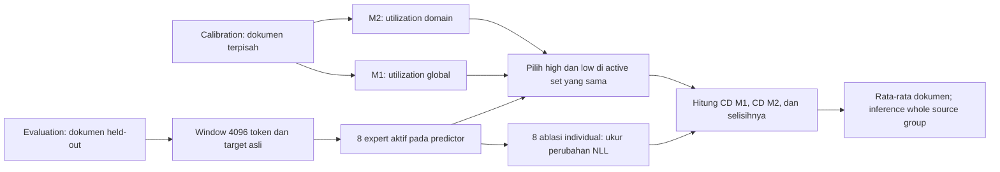
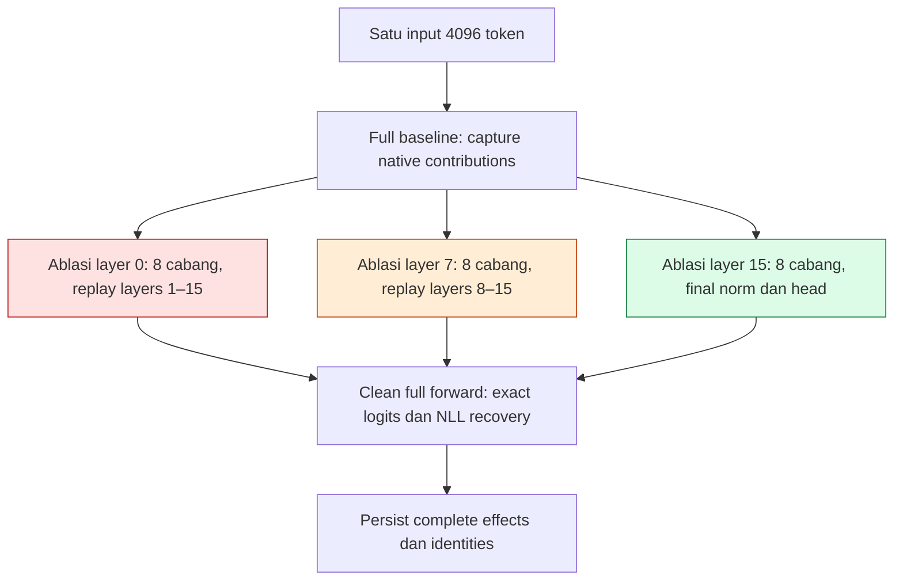
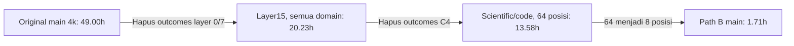
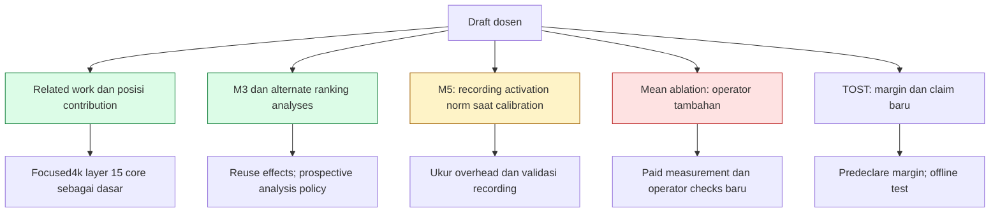

	# Memahami eksperimen sekarang dan Path B

Update2026-10-12: Arya memilih Path B; migrasi lokal sudah diimplementasikan,
native acceptance belum selesai. Lihat
[decision](../../configs/path-b-decision-v1.json) dan
[migration plan](PATH-B-IMPLEMENTATION-2026-10-12.md). Penjelasan di bawah
merekam comparison/proposal pada2026-10-11; forecast belum menjadi measured runtime.

Tanggal: 2026-10-11. Dokumen penjelasan untuk Arya; **bukan amendment protokol**.
Path B masih proposal. Angka buatan untuk belajar selalu ditandai; forecast
dipisahkan dari measurement GPU yang benar-benar sudah dilakukan.

**Gagasan utamanya:** Path B mempertahankan pengukuran kausal yang sama pada
layer 15/4k, mempertahankan keragaman sumber utama, lalu mengurangi pengulangan
dalam dokumen dan membatasi pertanyaan pendukung. Ini sangat mengubah kebutuhan
komputasi. Harga ilmiahnya adalah presisi yang belum diketahui dan cakupan
kesimpulan yang lebih sempit.

Urutan baca: pahami satu measurement (§1–3), penyebab biaya (§4–6), lalu
pertukaran ilmiah dan peluang artikel (§7–11).

## 1. Apa sebenarnya yang ingin kita ketahui?

Bayangkan router sebagai sistem yang memilih delapan dari 64 expert untuk setiap
token. Kita punya dua cara membuat daftar expert yang sering dipilih:

- **M1:** sering dipilih menurut campuran domain web, scientific, dan code.
- **M2:** sering dipilih khusus dalam domain yang sedang dievaluasi.

Daftar itu dibuat dari **calibration**, melalui forward tanpa ablasi. Ia
menunjukkan kebiasaan pemilihan expert. Kita kemudian menguji daftar itu pada
dokumen lain: apakah expert yang diberi skor lebih tinggi memang punya dampak
loss lebih besar ketika kontribusinya dihapus?

Kata "kausal" datang dari tindakan menghapus kontribusi dan mengukur perubahan
prediksi. Kita tidak mengintervensi domain, tidak melatih ulang model, dan tidak
menghapus expert secara permanen dari model.

Pertanyaan primary:

> Pada OLMoE dengan input 4096 token, apakah ranking utilization scientific/code
> memberi high-versus-low discrimination yang lebih besar daripada ranking
> utilization global, ketika expert aktif diintervensi pada layer 15?



M1 kita punya definisi spesifik: rata-rata tiga tabel domain dengan bobot sama.
Dalam setiap domain, calibration documents juga dirata-ratakan dengan bobot
sama, kemudian tiga seed tables dirata-ratakan. Dokumen panjang atau domain
besar tidak otomatis mendominasi M1.

## 2. Satu posisi, satu window, satu event: bedanya apa?

| Objek | Makna | Perannya dalam jumlah sampel |
|---|---|---|
| Source group | Paper ID, repository component, atau hostname | Unit sampling/resampling yang menangani dependensi sumber |
| Dokumen | Paper, file kode, atau halaman web | Efek posisi dirata-ratakan dalam dokumen |
| Predictor position | Posisi token yang memprediksi token berikutnya | Pengukuran berulang dalam dokumen |
| Input/window |4096 token berakhir pada predictor tersebut | Objek yang diproses model |
| Layer-event | Hasil pada satu window dan satu layer | Memuat baseline, route, dan delapan effects |
| Expert effect | Satu perubahan NLL dari satu ablasi | Delapan effects pada event yang sama saling bergantung |

Untuk predictor di posisi tertentu, kita mengambil 4095 token sebelumnya plus
token predictor. Target adalah token berikutnya yang asli, **di luar input**.
Loss yang diukur adalah loss target itu, bukan rata-rata loss semua 4096 token.

Mengukur delapan posisi dalam satu dokumen biasanya berarti **delapan windows
yang masing-masing diproses sendiri**. Windows dapat tumpang tindih, tetapi
konteksnya berbeda. Collector yang sekarang tidak menggabungkan delapan posisi
menjadi satu baseline pass.

Ini alasan jumlah posisi sangat memengaruhi biaya:64 posisi/dokumen berarti
hingga 64 pekerjaan window. Angka64 itu juga berbeda dari 64 expert/layer.

## 3. Worked example: bagaimana M2 bisa menang?

**Semua angka dalam contoh ini fiktif, bukan hasil penelitian.** Anggap pada
satu predictor scientific di layer 15, delapan expert aktif berikut ditemukan.
Baseline actual-next-token NLL adalah2.00 nats.

| Expert aktif | M1 utilization | M2 scientific utilization | NLL setelah expert ini diablasi | Delta NLL |
|---|---:|---:|---:|---:|
|3|.22|.11|2.02|+.02|
|8|.18|.24|2.12|+.12|
|14|.16|.19|2.06|+.06|
|21|.15|.13|2.03|+.03|
|33|.13|.08|2.01|+.01|
|40|.11|.15|2.04|+.04|
|52|.09|.07|1.99|−.01|
|61|.05|.04|1.98|−.02|

Utilization adalah membership frequency dari calibration. Nilai pada delapan
expert terpilih tidak harus menjumlah satu; keseluruhan64 expert menjumlah
delapan karena setiap token memilih delapan expert.

M1 memilih expert3 sebagai high dan 61 sebagai low:

```text
CD_M1 = effect(3) - effect(61) = .02 - (-.02) = .04 nats
```

M2 memilih expert8 sebagai high dan 61 sebagai low:

```text
CD_M2 = effect(8) - effect(61) = .12 - (-.02) = .14 nats
delta = CD_M2 - CD_M1 = .14 - .04 = +.10 nats
```

Pada posisi ini, M2 membuat pemisahan high/low yang lebih baik. Kita mengulangi
pengukuran pada posisi dan dokumen lain sebelum menarik kesimpulan populasi.

Setiap baris tabel berasal dari intervensi tersendiri yang dimulai dari baseline
yang sama. Kita tidak men-zero-kan delapan expert sekaligus. Bobot tujuh survivor
lokal tidak dinaikkan untuk mengompensasi expert yang dihapus.

Ada dua batas interpretasi penting:

- Bila M1 dan M2 memilih pasangan yang sama, delta tepat nol. Event itu tetap
  ikut; ia menunjukkan bahwa domain conditioning tidak mengubah pilihan di situ.
- Delta positif menunjukkan keunggulan relatif. Misalnya CD_M1=−.08 dan
  CD_M2=−.03 memberi delta=+.05, tetapi kedua ranking masih berlawanan dengan
  arah causal discrimination yang diharapkan. Kita harus melaporkan absolute
  CD_M1 dan CD_M2, bukan selisih saja.

Primary akhirnya adalah setengah mean scientific ditambah setengah mean code.
Mean domain memakai document means. Untuk code, files tetap document-weighted,
sedangkan ketidakpastian dihitung dengan meresample whole source groups.

## 4. Apa yang sudah berjalan, dan apa yang masih rencana?

Desain yang berlaku masih [README root](../../README.md) dan
[research.json](../../configs/research.json). Main belum punya final pilot-approved
allocation/freeze. Kita belum punya hasil ilmiah yang menjawab apakah M2 menang.

Yang sudah diuji di GPU adalah collector diagnostic: enam windows dari tiga
documents/groups, dengan matched 4096/2048 inputs. Semua 144 independent native
comparisons yang diuji lolos; numerical error yang tercatat nol. Ini evidence
untuk cases tersebut, belum acceptance seluruh technical set atau bukti power.

Ada **dua perubahan terpisah** yang jangan dicampur:

| Perubahan | Status | Apa yang berubah? |
|---|---|---|
| Reference consolidation,3→2 full forwards | Sudah diimplementasikan dan didiagnosis di GPU | Cara menjalankan measurement; science dipertahankan |
| Path B | Proposal; belum diimplementasikan | Jumlah measurements, scope layer/context/domain, dan planning |

Reference consolidation memakai mandatory clean native forward sebagai reference.
Pada diagnostic 4k, durable collection layer 15 berubah2.842→1.901 detik/input
(33.10% lebih sedikit waktu). Tiga layer berubah13.518→12.605 detik (6.75%).
Path B memakai **collector sekarang yang sudah dioptimalkan itu**. Savings B
bukan penghematan3→2-forward yang dihitung ulang.

## 5. Kenapa layer bawah sangat mahal?

Collector optimized menjalankan baseline penuh sekali, menyimpan contribution
yang diperlukan, lalu membuat delapan cabang intervensi per layer. Setelahnya
ada clean full forward untuk membuktikan baseline logits/NLL pulih tepat sebelum
completed events boleh dipersist.

Untuk intervensi di layer 0, hidden state berubah sebelum15 layer berikutnya.
Kita harus meneruskan hasil perubahan itu melalui layer1–15. Untuk layer 7,
layer8–15 masih harus dijalankan. Downstream routing boleh merespons secara alami.
Kita tidak membekukan routing downstream supaya menjadi lebih murah.

Untuk layer 15, **tidak ada decoder layer berikutnya**. Cached native expert
contributions direkomposisi dengan satu contribution dihapus; residual digabung,
lalu final normalization dan prediction head menghitung loss. Implementasi
sekarang masih mempertahankan full tensor shapes/reduction policy yang diperlukan.



Cabang digambar terpisah untuk menjelaskan dependensi; collector saat ini
menjalankannya berurutan. Baseline/cleanup dibagi antarlayer dalam input yang sama.

Measured diagnostic 4k, tiga layer:

| Komponen | Mean detik/input |
|---|---:|
| Captured baseline |.953|
| Clean full forward |.941|
| Delapan effects layer 0 |6.946|
| Delapan effects layer 7 |3.717|
| Delapan effects layer 15 |.019|
| Durable total, termasuk overhead |12.605|

Tiga-layer input sekitar 6.63× waktu layer 15-only input (12.605/1.901). Effects
layer 0/7 memakai sekitar 85% dari waktu tiga-layer input. Meski hanya16 dari 64
posisi/dokumen mendapat lower-layer measurements, cabang mahal ini mendominasi.

Final-layer effects murah, tetapi baseline dan cleanup tetap harus memproses
seluruh model. **Hanya meneliti layer 15 tidak berarti hanya menjalankan layer 15.**
Itu juga tidak membuat original FP32 weights muat di GPU 24 GB: katalog tensor
files sekitar 27.677 GB, dan diagnostic memakai hingga 33.072 GB reserved GPU memory.

## 6. Dari 49 jam main ke1.71 jam: hitung setiap cut

Ini perhitungan untuk **minimum candidate allocation**, memakai transfer mean
timing diagnostic. Belum measured production duration dan belum final sample size.

Original main 4k punya 38,296 unique windows. Sebanyak 9,677 windows di antaranya
diukur pada tiga layer; sisanya layer 15 saja. Maka:

```text
T_main = (38,296 - 9,677) × 1.901406 + 9,677 × 12.605103 seconds
       = 48.999 hours
```

Ubah satu hal pada satu langkah supaya savings tidak saling dihitung dua kali:



| Langkah | Windows | Mean detik/window yang digunakan | Main hours | Saving langkah ini |
|---|---:|---|---:|---:|
| Original |38,296|Campuran1.901 dan 12.605|49.00|—|
| Layer15 saja |38,296|1.901|20.23|28.77h|
| Scientific/code saja |25,712|1.901|13.58|6.65h|
| Delapan posisi/dokumen |3,240|1.901|1.71|11.87h|

Main collection berkurang sekitar 96.5%, atau sekitar 28.6× dalam projected
duration. Jumlah windows berkurang sekitar 11.8×; penurunan waktu lebih besar
karena lower-layer branches yang mahal juga dihapus.

Original main memiliki 57,650 layer-events dan 461,200 expert effects. B memiliki
3,240 layer-events dan 25,920 effects. Ini hitungan main 4k saja; bukan seluruh
workflow, bukan jumlah sampel independen, dan bukan scientific sufficiency.

Seluruh delapan final-layer effects B hanya sekitar 62 detik total menurut mean
diagnostic. Menghapus semuanya pun hanya menghemat~.017 jam dari main B. Kita
mendapat banyak audit/control value dengan mempertahankannya.

## 7. Apa harga ilmiah dari penghematan itu?

Ada tiga dimensi yang perlu dibedakan: **keutuhan measurement**, **presisi
estimate**, dan **luas kesimpulan**.

Keutuhan measurement pada event yang dipertahankan tetap ditargetkan sama:
original FP32 model, context 4096, target asli, all-eight individual effects,
native coefficients, no replacement/renormalization, dan exact cleanup.
Path B tidak mendapat izin memakai toleransi yang lebih longgar.

Presisi berubah karena setiap dokumen mendapat delapan measurements, bukan64.
Lu bisa membayangkan mewawancarai 200 orang dengan delapan pertanyaan per orang
dibanding 64 pertanyaan. Banyak pertanyaan membantu mengenali tiap orang lebih
baik, tetapi64 jawaban orang yang sama tidak menjadi 64 orang independen.
Untuk code, beberapa files dalam repo yang sama juga tetap satu kelompok sumber.
Analogi ini hanya untuk memahami dependensi; sampling kita tetap token positions.

Dalam model sederhana, satu dokumen/group per unit independen:

```text
Var(mean) = (between-group variance + within-position variance / m) / n

n = jumlah kelompok independen
m = jumlah posisi per dokumen
```

Jika perbedaan antar-dokumen besar dan variasi posisi kecil,64→8 dapat hanya
sedikit mengubah standard error. Jika perbedaan posisi dalam dokumen mendominasi,
penaltinya bisa besar. Dalam model ini, rasio SE untuk8 versus 64 posisi mendekati
1 sampai sqrt(8)=2.83. **Ini bukan measured bound untuk data kita**; unequal
code-group sizes dan actual cluster inference memerlukan pilot nyata.

Karena itu, Path B juga mengubah pilot menjadi delapan posisi. Kita ingin
mengukur noise dari desain yang akan dipakai main. Pilot lama dua posisi tidak
membuktikan presisi desain baru.

Target planning tetap CI halfwidth .005 nat. Contoh hasil fiktif:

| Primary estimate dan 95% CI | Pembacaan yang dibolehkan |
|---|---|
|+.020 dengan[+.016,+.024]|Mendukung keuntungan positif; halfwidth .004 mencapai target planning |
|+.020 dengan[+.010,+.030]|Mendukung keuntungan positif, tetapi halfwidth .010 tidak mencapai target .005 |
|+.001 dengan[−.020,+.022]|Arah/ukuran keuntungan masih sangat tidak pasti |
|.000 dengan[−.003,+.003]|Membatasi ukuran efek dalam setting ini; klaim formal equivalence tetap memerlukan margin/prosedur yang disepakati |

Tabel mengasumsikan interval yang valid; domain-specific confirmatory claims
tetap memakai Holm. Kita tidak mengulang sampling sampai M2 menang.

Cakupan juga berubah:

| Evidence yang dicut | Pertanyaan yang tidak lagi dijawab |
|---|---|
|Layer0/7|Apakah hubungan utilization dan contribution berubah sepanjang depth? |
|C4 outcomes|Apakah keuntungan M2 juga terlihat pada sampled general-web documents? |
|Matched2048|Apakah temuan tetap berlaku ketika informasi konteks dikurangi? |
|Tambahan56 posisi/dokumen|Seberapa stabil document mean dan pola dalam dokumen pada sampling lebih padat? |

Yang masih dapat dijawab adalah expected paired M2-versus-M1 contrast untuk
scientific/code pada layer 15/4096, conditional pada frozen calibration. Uniform
position sampling dan document/domain weighting dipertahankan, sehingga target
expected mean tetap. Realized sample estimate dan uncertainty tentu bisa berubah.

C4 tetap wajib untuk calibration M1. Bila C4 calibration juga dihapus, global
baseline menjadi campuran scientific/code saja: itu perubahan scientific
comparison tambahan, bukan Path B yang diusulkan.

## 8. Seberapa game-changing untuk feasibility?

Angka49→1.71 h hanya main. Workflow juga memerlukan native mechanics,
independent optimized validation, technical timing, calibration, probe, pilot,
sealing/transfer, dan allowance setup/shutdown.

| Stage, jam sebelum reserve | Original design | Path B |
|---|---:|---:|
|Native mechanics|2.486|.516|
|Independent optimized validation|2.559|.437|
|Technical collection/timing|.854|.080|
|Calibration|1.888–3.775|1.175–2.350|
|Routing probe|.322|.201|
|Pilot|.063–.255|.169–.680|
|Main4k|48.999|1.711|
|Matched2k outcomes|7.438|0|
|Setup/hash/load/shutdown allowance|.500|.500|
|Additional I/O/seal/transfer allowance|.250|.250|
|Subtotal|65.36–67.44|5.04–6.73|
|20% reserve|13.07–13.49|1.01–1.35|
|**GPU/allocation total**|**78.43–80.93**|**6.05–8.07**|
|**Nominal compute/storage allowance**|**$87.06–89.83**|**$6.71–8.96**|
|Additional offline time allowance|.50|.50|

Original/B totals differ by roughly10–13×, or90–92% less projected allocation
time/cost. This moves the primary study from far outside an untouched$12/10 h
envelope to a candidate that might fit it.

The range uses calibration 250/pilot 20 versus calibration 500/pilot 80. It is
**not a runtime confidence interval**, and the upper end is not a proven worst
case. Calibration/probe timings use assumed full-forward proxies; calibration
serialization and native reconstruction overhead still need measurement.

The$1.11/hour rate is a historical compute+storage allowance, not a current
offer or invoice. Past spend and the original clock are not reset. Queue/build/
download time is excluded; unexpected launches/restarts require new accounting.
Pilot-selected sample expansion can raise costs above this minimum allocation.

This is game-changing for **budget feasibility**, with a conditional forecast.
It is not evidence that M2 predicts contribution, that eight positions suffice,
or that an article will be accepted.

## 9. Bisa artikel lebih luas tanpa mengembalikan semua biaya?

Ya, sebagian breadth dapat datang dari pertanyaan tambahan pada evidence yang
sama. Setelah eight effects tersedia, memilih pasangan expert lain dalam
baseline-active set tidak memerlukan menjalankan model lagi.

Contoh: pada worked example, suatu mismatched code table memilih expert40
sebagai high dan 61 sebagai low. Effects keduanya sudah tersedia:

```text
CD_mismatched = .04 - (-.02) = .06
CD_matched_scientific = .14
matched-minus-mismatched = +.08 nats
```

Ini memperluas pertanyaan menjadi apakah kesesuaian ranking dengan domain
evaluasi membantu. Ia tetap tidak membuktikan expert eksklusif milik domain
tertentu. Domain/source properties sendiri tidak diintervensi.

| Extension | Tambahan GPU | Hal yang harus dilakukan |
|---|---|---|
|Matched/mismatched M2|Tidak untuk same inputs|Analysis sudah menyimpan selections/CD; definisikan comparison dan uncertainty |
|M3 enrichment|Tidak jika computed dari frozen tables|Di luar core; freeze definition dan secondary/exploratory role |
|Ranking seluruh 8 active experts|Tidak dari complete effect census|Tentukan rank statistic, ties, document aggregation, cluster uncertainty |
|Token-weighted calibration sensitivity|Tidak jika raw windows lengkap|Label alternate estimator; pertahankan primary equal-document/equal-domain |
|M5 activation norm|Bisa berbagi calibration passes|Norm recording/reduction dan runtime/integrity checks baru; overhead UNKNOWN |
|TOST/equivalence|Tidak|Tetapkan meaningful nat margin dan test family sebelum main; dapat tetap inconclusive |

Delapan effects hanya mencakup delapan expert **yang aktif** pada event itu.
Kita tidak memiliki causal effects semua 64 expert. Juga, delapan single-expert
effects tidak bisa dijumlahkan begitu saja untuk memprediksi multi-expert
removal: interaksi downstream/output dapat mengubah hasilnya.

Breadth melalui reuse ini tetap punya biaya engineering/offline analysis dan
masalah multiple testing. Predeclare claims yang penting; analysis setelah
melihat hasil diberi label exploratory. Banyak plots dari data yang sama tidak
menambah independent source evidence.

Jika ingin mengembalikan satu axis pengukuran baru:

- **C4,200 dokumen×8 posisi:**1,600 tambahan windows; outcome time~.845 h.
  Dengan 20% reserve,~1.014 h/$1.13. Ini outcome-only estimate, belum full extension
  cost untuk pilot/planning/I/O/restart. Memulihkan evaluasi kausal third domain.
- **Layer15-only matched 2k:** audit memperkirakan1.73–2.44 h sebelum reserve/I/O,
  sekitar$2.30–3.25 dengan 20% reserve. Harus ada 2k calibration/probe/technical
  dan same-target outcomes; reuse4k rankings saja bukan matched-context study.
- **Mean ablation atau lower-layer subset:** perlu independent measurements dan
  operator/scope validation. Complete incremental cost belum diketahui. Mengukur
  beberapa contoh saja tidak memulihkan seluruh klaim lower-layer population.

B+matched 2k nominalnya~$9.01–12.21, belum historical spend. Untuk biaya terbatas,
gue akan menjaga precision primary sebelum menjanjikan semua extension.
Extension dipilih sebelum main results, bukan setelah melihat hasil yang menarik.

## 10. Apa tepatnya yang ditambahkan draft Arya dari dosen?

Sumber yang dibandingkan adalah [draft-teori-dasar-arya.md](../draft-teori-dasar-arya.md).
Dokumen itu berlabel proposed draft dan beberapa keputusan masih diusulkan.
Ia memperkuat literature framing sekaligus membawa detail desain lama.

| Isi draft                                    | Dibandingkan README/Path B                              | Dampak ilmiah dan biaya                                                               |
| -------------------------------------------- | ------------------------------------------------------- | ------------------------------------------------------------------------------------- |
| Replication and extension terhadap Engmann   | Memperjelas related work; primary M2-minus-M1 tetap     | Biaya GPU framing nol; exact replication perlu mencocokkan corpus/context/runtime     |
| M3 termasuk formula framework                | README menempatkan M3 di luar core                      | New metric comparison; effects bisa dipakai ulang, perlu keputusan analisis           |
| M5 activation norm                           | Belum measurement yang diterima                         | Membandingkan dengan predictor berbeda; calibration overhead belum measured           |
| Mean ablation subset                         | Operator baru selain zero contribution                  | Mengurangi ketergantungan pada pilihan operator; menambah measurements/gates          |
| TOST dengan SESOI dari pilot M4              | Core sekarang menggunakan CI tanpa practical-null claim | New claim dan margin; tidak otomatis sah dari hasil nonsignificant                    |
| 200 posisi per domain                        | Current minima200 scientific documents/200 code groups  | Perbedaan besar pada independensi dan sample size; tidak interchangeable              |
| Token dianggap independent, cluster optional | Cluster inference source-group wajib saat ini           | Mencegah pseudoreplication; code files satu repo tidak independent                    |
| Pooled-token M1                              | M1 saat ini equal-document lalu equal-domain/seed       | Baseline dan target comparison bisa berubah; Path B mempertahankan current definition |
| Bootstrap percentile per token               | Current whole-group bootstrap-t                         | Estimator uncertainty berbeda; bukan perubahan otomatis                               |
| Fully tied events dikeluarkan                | README mempertahankan ties dan identical pairs          | Exclusion dapat memilih populasi dengan disagreement lebih besar                      |
| Layer lain/routing disebut tidak berubah     | Local survivor route tetap; downstream dihitung alami   | Membekukan downstream pada lower layers mengubah intervention semantics               |
| Tolerance berasal dari BF16                  | Current original FP32 dan tolerances beku               | Tidak boleh mengadopsi BF16 tolerance untuk mempercepat acceptance                    |
| M4 gagal berarti implementasi salah          | README membedakan mekanisme salah dan valid weak signal | M4 lemah memicu checks; bukan alasan menjamin positive result                         |

Usulan D2 mengatakan ablasi mungkin bertambah jika high/low M5 berbeda. Dalam
collector kita yang mengukur **seluruh 8 effects**, pasangan M5 mana pun di active
set yang sama sudah punya effects. Perubahan pasangan tidak menambah ablasi.
Tetapi norm calibration belum disimpan; kita tidak bisa memulihkannya hanya
dari expert IDs dan routing weights.

Untuk SESOI, Cohen's dz bersifat dimensionless. Mengubah setengah dz M4 menjadi
margin dalam nat memerlukan scale statistic yang ditentukan jelas; tidak bisa
menaruh angka dimensionless langsung sebagai nat threshold. Meaningfulness
margin juga perlu alasan substantif, bukan hanya mudah dihitung dari pilot.

Paper terdekat menguji metrik global dan per-token routing-weight control pada
WikiText-2. Ia memberikan dasar untuk membingkai studi ini sebagai extension
ke domain-conditioned predictors. **Klaim "first" masih memerlukan prior-art
search lebih lengkap.** [Engmann dkk., versi2](https://arxiv.org/html/2606.10703v2)



## 11. Rekomendasi gue dengan target artikel dan dana minim

Urutan prioritasnya:

1. **Pertahankan primary question dan measurement integrity.** Exact 4k/layer 15,
   FP32, all-eight effects, full source-group safeguards, and truthful uncertainty.
2. **Gunakan delapan-posisi pilot untuk admission.** Cari tahu apakah sumber
   variansi memungkinkan precision yang cukup dalam sisa budget. Jika tidak,
   pilih precision-limited reporting atau insufficient-pilot stop sesuai keputusan.
3. **Bangun article breadth dari same evidence.** Matched/mismatched, absolute
   CDs/controls, ranking agreement/disagreement, dan sensitivity pembobotan.
   Pertimbangkan M3 dengan prospective definition.
4. **Pertimbangkan M5 sebelum calibration dijalankan.** Recording norm sejak awal
   dapat menghindari repeat calibration untuk extension, jika overhead/gates muat.
5. **Tambahkan satu paid measurement axis hanya jika complete forecast muat.**
   C4 memberi domain breadth;2k memberi context robustness;mean ablation memberi
   operator robustness. Ketiganya menjawab ancaman validitas yang berbeda.

Ini rekomendasi paket, belum keputusan implementasi. Sebuah studi fokus dapat
punya narrative artikel yang kuat jika estimate, controls, related work dan
limitations jelas. Lebih banyak conditions tidak menjamin kontribusi lebih baik
atau publication acceptance.

Path C tetap opsi radical: shared windows, banyak predictor rows, context efektif
4081–4096, projected~5.9–7.7 h/$6.5–8.5. Ia mengubah position population dan
memerlukan collector/assurance baru. Karena forecastnya mirip B dengan engineering
risk lebih tinggi, belum ada alasan evidence-based untuk menganggapnya upgrade
gratis dari B.

## 12. Apa yang harus berubah di script jika B disetujui?

Mengganti64 menjadi 8 diJSON saja tidak cukup. Current plans, receipt scope,
allocation dan analysis saling mengunci.

| Area | Perubahan yang diperlukan |
|---|---|
|Preparation/plans|Versioned context/layer/domain policy;8 uniform nested positions; whole code groups |
|Pilot/main planning|Variance dari 8-position pilot; allocation dan remaining-stage budget untuk desain baru |
|Native/optimized acceptance|Receipt untuk scope 15/4096; thresholds tetap; old diagnostic tidak jadi full PASS |
|Collector|Terima scoped plans/receipts dengan fail-closed identity; measurement arithmetic B dipertahankan |
|Analysis/reporting|Absennya C4/lower/2k dilabeli; claims/precision policy dan comparison family jelas |
|Reuse/provenance|Old measurements tidak diberi identity baru; raw evidence dan frozen predecessor tetap traceable |

Current source yang diverifikasi untuk penjelasan teknis:
[`measure_input` dan `_replay_from_layer`](../../src/run_experiment.py),
[`RoutingCapture`](../../src/interventions.py), dan authoritative sampling
rules di[README](../../README.md). Graph snippet ranges menunjukkan drift;
actual current source dipakai sebagai authority.

Ada alasan kita menahan numerical executor changes untuk B: floating-point
computations dengan shapes/reduction order berbeda dapat menghasilkan angka
berbeda meskipun secara matematika sama. Executor baru perlu differential
validation sendiri. [PyTorch numerical accuracy](https://docs.pytorch.org/docs/main/notes/numerical_accuracy.html)

## 13. Cek apakah penjelasannya sudah masuk

| Pernyataan | Jawaban dan alasan |
|---|---|
|"Layer15-only berarti tidak menjalankan layer 0–14."|Salah. Baseline/cleanup tetap full model; cabang intervensinya yang pendek. |
|"64 posisi satu paper berarti 64 paper independen."|Salah. Posisi adalah repeated measurements; paper/source group menentukan dependence handling. |
|"Memotong2k berarti input primary ikut dipendekkan."|Salah. Primary tetap4096; matched experiment tambahan yang didefer. |
|"M5 memilih pasangan berbeda, jadi pasti perlu ablasi baru."|Tidak pada same baseline-active set dengan eight effects lengkap; norm calibration tetap perlu dicatat. |
|"Path B mencapai 6 h, jadi scientific power pasti cukup."|Salah. Runtime dan scientific precision adalah dua admission questions berbeda. |
|"M2 lebih baik dari M1 berarti M2 pasti valid positif."|Salah. Relative advantage dapat terjadi ketika absolute CDs keduanya negatif. |
|"Tak signifikan berarti kedua metrik setara."|Salah. Bisa karena uncertainty; formal equivalence memerlukan margin dan prosedur. |

Kalimat yang perlu bisa lu jelaskan dengan kata-kata sendiri:

> Kita menjaga scientific/code source breadth dan pengukuran kausal layer 15/4k,
> mengurangi repeated windows dan scope tambahan, lalu memakai pilot untuk
> menilai precision. Delapan effects per event memberi kesempatan memperluas
> analisis artikel tanpa selalu menambah GPU measurements.

## Sumber lokal dan cara membaca evidence

- [README](../../README.md): desain yang berlaku, khususnya amendment2026-10-10.
- [Feasibility findings](FRESH-FEASIBILITY-FINDINGS-2026-10-11.md) dan
  [machine-readable ledger](fresh-feasibility-findings-2026-10-11.json): proposal,
  exact counts, stage forecasts, blockers.
- [Paired diagnostic results](OPTIMIZATION-PAIRED-RESULTS-2026-10-11.md): measured
  timing/agreement pada small diagnostic, bukan complete study.
- [Draft Arya dari dosen](../draft-teori-dasar-arya.md): literature/theory proposals
  yang direkonsiliasi pada§10, bukan pengganti current authority.
- [Ringkasan comparison](RESEARCH-SCOPE-COMPARISON-2026-10-11.md): tabel ringkas.

MEASURED=raw observation; DERIVED=calculation; ASSUMED=prospective allowance;
UNKNOWN=belum ada evidence. Fiktif=teaching example, tidak masuk scientific dataset.
Dokumen ini tidak mengubah science settings atau meluncurkan pekerjaan berbayar.
