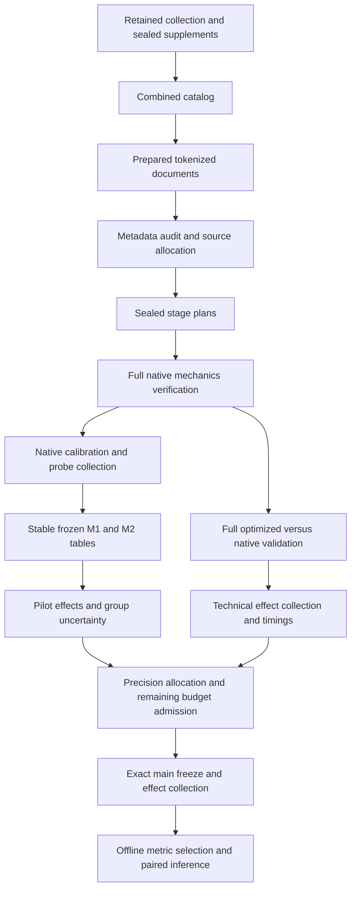

# Path B — system mapping and diagnosis handoff to Astra

Investigator: Sol. Inspected 2026-10-13 in `/home/arya/School/TA/DSIC-3007`.
Scope: current Path B source, local artifacts, and retrieved RunPod evidence.
This is an investigation and decision handoff. No implementation, experimental
settings, dependencies, or cloud resources were changed.

## 1. Assessment and evidence boundary

Path B has a coherent local scientific pipeline: reviewed inputs, deterministic
plans, native routing/effects, calibration freeze, paired source-group analysis,
pilot planning, and main freeze. Its current operational path has **not completed
model loading, native acceptance, or collector timing on the latest attempt**.
There are also two reproducible integration defects: current measurement bundles
cannot pass the R2 transfer allowlist, and offline analysis can substitute a
different frozen calibration without enforcing the collection's calibration hash.

The latest raw evidence is newer than the status described in README. The v11
benchmark grant has already been used. Its pod was deleted with a retrieved
cleanup receipt; the model volume was retained. No new attempt is authorized by
this report. Published commands and decision JSON alone do not describe the
current execution state.

The main complexity comes from contracts distributed across configuration,
manifests, receipts, source packages, runtime identity, and local attempt history.
Some protect the estimand and raw evidence. Others bind unrelated documentation,
historical tools, and specific account infrastructure into a three-window
diagnostic. These boundaries explain why apparently small edits propagate.

Evidence labels used below:

- **Verified source:** behavior established by current source and consumers.
- **Reproduced locally:** an existing offline test or bounded synthetic diagnostic
  exercised the behavior; this is not pretrained GPU or statistical evidence.
- **Retrieved runtime evidence:** saved output from an earlier user/cloud run,
  inspected locally; no live cloud verification was performed in this audit.
- **Hypothesis:** a plausible cause or consequence that the available evidence
  does not establish.

The graph was refreshed before code discovery. Source verification was necessary:
even the refreshed graph attributes ordinary dictionary `.get` calls to
`ObservationReuseIndex.get`, and argparse `parse_args` to a collector function.
Those edges are not reliable dependencies. Maps here use verified imports and
source calls, not graph degree as a quality score.

Git has two commits; HEAD is `ce9d2a2`, the 2026-10-08 consolidation. Much of the
current pipeline is modified or untracked. Git history cannot reconstruct the
Path B migration or today's runner fixes. The v11 frozen source package does
provide a specific source snapshot for that diagnostic. There is no on-disk root
AGENTS.md; the instructions supplied in the task were applied.

## 2. Research authority and invariants

The Research Master in this checkout is [README.md](../../README.md). Its Path B
amendment and [research-path-b-v1.json](../../configs/research-path-b-v1.json)
define the active study. [path-b-decision-v1.json](../../configs/path-b-decision-v1.json)
records the scope selection; it explicitly is not executable settings.
`configs/research.json` is historical. The supervisor theory draft informs the
motivation and possible extensions, but its M3/M5/equivalence suggestions are not
selected requirements. The manuscript remains a section skeleton.

| Invariant | Requirement future changes must preserve |
|---|---|
| Model | Original base OLMoE FP32 branch, revision `c6f6954f182ffdd9f6ab4f4d772714b7dcd6836b`; 16 layers, 64 experts, top-8, no training or quantization. |
| Input/outcome | Exactly 4096 original tokens from one document; local predictor 4095; actual next token outside the window; manual next-token NLL in nats, excluding router auxiliary loss. Current logits originate in FP32 and log-softmax uses float64. |
| Intervention | Layer 15, one naturally active expert's contribution zeroed at one predictor; no replacement or survivor renormalization; all eight individual effects anchored to the same baseline. |
| Numerical validity | Exact routes/coefficient bytes, unchanged survivors and cleanup; mixture/logit `atol=1e-6`, `rtol=1e-5`; NLL absolute tolerance `1e-6`. Preserve expert row order, native batch shapes, and accumulation order. |
| Calibration | C4/scientific/code, equal document and seed weights; equal three-domain M1; seeds 3008/3009/3010; nested 100/250/500 ladder. Observe all input positions in one window/document/seed. Freeze candidate 250 or 500 under the selected drift/Jaccard rule. |
| Sampling | Seed 3007; audited source-group separation across technical, calibration, probe, pilot, main; uniform nested eight positions/document for pilot/main, all available if fewer; every eligible file in selected code groups. Retain tied events and identical metric pairs. |
| Endpoint | Within-document paired `delta = CD_M2 - CD_M1`; equal document means within each domain; primary `0.5 scientific + 0.5 code`. Code is document weighted, with whole groups used for uncertainty. |
| Inference | Whole source-group bootstrap-t with multiplicities and unequal group sizes; 2000 planning/10000 final draws, >=95% valid draws; two scientific/code secondary tests with Holm. Eight effects and repeated positions are not independent source observations. |
| Prospective main | At least 200 scientific documents and 200 code groups; pilot-driven precision target halfwidth .005 nat; exact IDs, positions, calibration and analysis frozen before main outcomes. No extension based on significance. |
| Scope exclusions | No Path B pilot/main C4 effects, lower-layer outcomes, or matched-2048 sensitivity. M3/M5, mean ablation, and equivalence claims remain separate decisions. |
| Evidence preservation | Retain individual routes, FP32 coefficient bytes, baseline/ablated NLLs and deltas, exact inputs/targets, source/sampling identity, completeness and failures. A partial run must not become a complete-case scientific sample. |

Two distinctions matter for Astra:

1. The **scientific property** is reliable measurement and reproducible selection.
   The chosen implementation of that property—nine-file implementation digest,
   repeated full forwards, particular manifest schema, private registry, SSH,
   Terraform, R2, authorization ID spelling—is an engineering choice. Changing a
   mechanism still needs evidence that its protected property survives.
2. Budget caps and one-attempt grants protect the user's resources. They are
   operational constraints, not properties of M2 or bootstrap-t. The precision
   fallback is still an unresolved research/reporting decision, not permission to
   weaken a numerical gate or reduce scope silently.

`scope.py:13–57` duplicates many selected values as executable literal checks.
It returns legacy behavior when `protocol` is absent and rejects modified Path B
policy when present. Scope identity is the policy plus the canonical digest of
the entire settings object (`scope.py:77–84`). Thus even narrative settings
changes can change artifact identity without changing computations.

## 3. Current execution and data map

### 3.1 Scientific pipeline



This diagram describes the implemented dependency order, **not completed stages**.
The bounded benchmark described in section 4 is a separate diagnostic path.

| Component | Verified responsibilities and consumers |
|---|---|
| `src/collection.py`, `src/collectors/` | Acquisition from pinned sources. Supplemental collection scans a bounded stream; old retained collectors have a separate environment. They are upstream of prepared inputs, not required for an already prepared GPU diagnostic. |
| `src/preparation.py` | Catalog verification, unchanged tokenization, exact eligibility, seeded position ordering, context windows, source-review validation, stage plans. `data.py` now reexports these entry points. |
| `src/source_audit.py`, `src/allocation.py` | Summarize metadata, connect recorded aliases/duplicate identities, exclude ambiguous variants, allocate disjoint source components, record every included/excluded document. |
| `src/scope.py` | Active/legacy policy, stage domains/layers, settings/scope binding, plan shape validation. Used by preparation, verification, collection, calibration, analysis, planning, and the diagnostic. |
| `src/model.py` | Pinned model checks, FP32/eager single-GPU load, runtime and implementation identity, reusable loaded session. |
| `src/interventions.py` | `RoutingCapture` hooks native eager experts; captures routes, optionally whole windows and native-shaped contributions; applies the local zero coefficient; restores hooks/forward overrides. |
| `src/run_experiment.py` | Full forward/NLL, optimized suffix replay, raw event measurement, receipt gates, journal/resume, optional nested observation reuse, timing sidecar, sealed measurements. |
| `src/verify.py`, `src/optimized_validation.py` | Native mechanics and separately executed native-ablation comparisons for the optimized executor. Full acceptance and diagnostic scopes are distinct. |
| `src/routing_stats.py`, `src/analyze.py` | Calibration membership tables, stability/freeze, shared tie ordering, M0/M1/M2/M4 pair selection, CD/delta, document/group summaries, bootstrap-t, pilot diagnostics. |
| `src/planning.py`, `src/admission.py` | Use sufficient pilot variance and full technical timings to select the fastest qualifying source allocation, check remaining-work ledger, freeze exact main inputs. |
| `src/artifacts.py`, `src/reuse.py`, `src/observation_contract.py` | Sealed bundle integrity, atomic writes, complete-event journal; exact input/executor/source matching for reusable observations with fresh consumer sampling lineage. |
| `src/workflow.py` | CLI dispatch. New preparation/planning defaults to Path B; collection and analysis generally consume settings saved in the plan. |
| `src/transfer.py`, `src/reporting.py` | Private bundle transport and readable local results. Transport currently has an incompatible measurement schema; see F1. |

Source anchors: `workflow.py:95–205, 285–334`; `preparation.py:182–199,
249–310, 343–437`; `run_experiment.py:213–436`; `analyze.py:313–580, 695–1047`;
`planning.py:18–241`.

### 3.2 Actual measurement path

For an optimized layer-15 effect input, `measure_input`:

1. Captures native-shaped expert contributions and the post-attention residual
   during one full baseline forward.
2. Reconstructs the predictor's MoE mixture eight times, zeroing one coefficient
   each time; adds the residual and runs final model normalization/output to get
   eight actual target NLLs. At layer 15 there are no downstream decoder layers.
3. Removes instrumentation and runs an uninstrumented full cleanup forward.
   Baseline NLL and predictor logits must recover exactly before returning any
   complete events.
4. Returns routes, raw NLLs/deltas, synchronized timings, allocator peaks and
   process peak RSS. `collect` persists events and input timing after completion.

This costs **two full forwards plus eight suffix replays per input**. The native
effect alternative costs baseline + eight ablations + cleanup = ten full forwards.
Native calibration/probe currently also use two full forwards: routing capture
and exact cleanup, without ablation. These counts follow current source, not a
GPU timing estimate (`run_experiment.py:115–200`).

The optimized path copies the inspected Transformers eager expert loop and
recomposes with ordered `index_add_`, rather than subtracting a weighted vector
from an already rounded sum (`interventions.py:91–155`). This numerical detail
serves correctness. Generic lower-layer replay still captures layer invocation
arguments and can replay downstream decoder layers; Path B uses only its
layer-15 case (`run_experiment.py:68–112`). No need for lower-layer *outcomes*
follows from retaining that shared machinery.

Full native mechanics consumes 13 full forwards/input/layer: baseline, two
determinism repeats, no-op, eight masks, cleanup. Independent optimized validation
uses 11 full forwards plus eight suffix replays/input/layer. It compares captured
baseline, every ablated NLL/logit/mixture, routes/survivors/untargeted rows, and
cleanup/parameter versions. On the saved 152-input technical plan, native
mechanics + optimized validation + optimized technical collection imply **3952
full forwards and 2432 suffix replays**, excluding additional layer reconstruction
work and loading. These are source-derived workload counts, not observed runtime.
The additional checks establish different properties, but their separate
execution and repetition are choices for Astra to assess.

### 3.3 Data, configuration, and artifact relationships

The current prepared successor is
`data/prepared-inputs/path-b-v1-2026-10-12/`. It reuses verified tokenized bytes from
the combined inventory under new settings; it does not repeat acquisition or
tokenization. Its asset payload is 582,096,733 bytes. Its review is
`data/manifests/path-b-v1-source-review-2026-10-12.local.json`.

That review reports no allocation shortfalls and eligible totals of 7164
scientific documents/groups and 3797 code files in 3703 groups. It leaves 6540
scientific documents and 3092 code groups/3171 files for main. These are local
reviewed inventory counts, not final main observations or proof of independence
against unknown relationships. C4 supplies calibration/probe/technical only.

All 12 saved Path B plans passed fresh local bundle and scope validation:

| Plan family | Actual saved design count | Interpretation |
|---|---:|---|
| Technical | 12 groups/domain; 38 documents; 152 windows | Four positions/document; whole selected groups. Full technical shape validator also passed offline. |
| Probe | 32 documents/domain; 384 windows | Four positions/document; route-only. |
| Calibration 100 | 300 windows per seed, three seeds | Nested documents, one window/document/seed. |
| Calibration 250 | 750 windows per seed, three seeds | Saved alongside 100; 500 is not materialized here. |
| Pilot 20 / 40 / 80 | 320 / 640 / 1288 windows | Code units are groups; pilot-80 contains 81 code files and 80 scientific documents. |
| Minimum-main dry-run | 200 scientific documents + 205 code files in 200 groups; 3240 windows, 25,920 effects | **No main freeze.** Census only; `collect` requires the separate pilot-approved freeze. |

A plan contains selected tokenized documents, explicit 4096-token windows and
targets, copied settings, full source review, and model catalog. Its manifest
hashes each file and records scope, review/prepared/tokenizer identity, stage,
seed, units, window and layers. Input ID hashes document/tokenized-content/window/
target identity; event ID hashes input ID and layer (`preparation.py:417–437`;
`run_experiment.py:64–65`).

A measurement run copies its sealed plan and, for pilot/main, frozen calibration.
Its identity binds executor, execution mode, plan manifest and calibration
manifest. Its manifest hashes those copies, events, timing/failure sidecars and
receipts. Journal resumption requires the same identity; only complete events
count. Nested calibration/pilot reuse is optional and additionally requires exact
raw input/source/operator/executor identity. It strips old timings and regenerates
consumer sampling metadata (`reuse.py:159–271`). It does not turn reused work into
new independent data.

Calibration freeze binds the raw calibration/probe bundles and source/executor
metadata, saves per-document/per-seed statistics, averaged tables, rankings,
ties, drift/Jaccard comparisons and probe pair selections. In Path B each
seed-pair/budget stability family has **three domain-layer comparisons**. A >=90%
threshold therefore requires all three to pass; it cannot tolerate one failing
domain. This is a consequence of the selected scope, not a new proposed rule
(`analyze.py:677–692, 818–855`).

Main planning uses complete technical timings, a sufficient eight-position pilot,
frozen calibration and the reviewed pool. It projects cluster variance by group
count; searches nested code prefixes and the smallest qualifying scientific
prefix; then minimizes projected runtime. Admission separately requires explicit
remaining costs/evidence for ten non-main stage categories, reconciled cash/time,
live quote reference and >=20% reserve. `freeze_main` rechecks admission and seals
the exact allocation. These remain conditional projections, not achieved power.

## 4. RunPod infrastructure and operational flow

### 4.1 The active control path

```text
User command: runpod/path_b_preflight.py
  -> frozen v11 source/three-input package verification
  -> Global Volume decision config and local authorization history
  -> global_preflight: setup receipt, live volume/registry/pods/GPU quote
  -> screen.run_attempt: lease, attempt identity, independent cleanup guard
     -> GraphQL deploy with OBJECT_STORE_VOLUME attachment
     -> REST v2 pod read-back + direct SSH probe
     -> SCP archives, operation identity, separately copied remote helper
     -> screen_remote.py: extraction/hash/runtime/plan/cache-presence gates
        -> path_b_benchmark.py
           -> TimedModelSession -> model.load_model(verify_weights=False)
           -> validate_optimized(scope=preflight): 24 native comparisons
           -> one warmup + three optimized collector measurements
     -> SCP result directory to local attempt
     -> REST delete own disposable pod + cleanup read-back
```

No scientific stage sequence is automatically launched by this path. It is a
three-window diagnostic, even if every comparison and timing passes. Optimized
collection still requires `full_technical` validation plus native mechanics;
diagnostic receipts explicitly have no collection approval.

The current package is
`data/optimization/path-b-global-preflight-2026-10-13-v11/`. Fresh offline package
verification passed: 42 protected source/config/document files, a 310,104-byte
source archive and 4,211,899-byte screen archive. Implementation digest:
`4f989f16859917d9a85073e081eaacf1f84894e7fdbdeb93ddf11f1bfe52cb81`.
Settings canonical digest:
`fedad542574e7a68bed07d5e3cacf37d6b5d4bc648c4c369cdbad6e9beeff01d`.

Provisioning uses a digest-pinned private image, a specific registry credential
ID/name, L40S Secure Cloud, one GPU, host-memory request 64 GB, CUDA-compatible
placement and a 35 GB container disk. It mounts Global Volume
`cmv66f04p000007l8gngvd5k4` at `/workspace-global`. Placement follows GPU stock
rather than a regional network-volume restriction. These are current configured
choices and saved evidence, not a live capacity or price assertion.

`global_api.py` contains small hand-written GraphQL calls derived from a pinned
official SDK source. The Python RunPod SDK itself is not imported. Reads,
readiness, logs, and deletion use REST v2 via curl. `screen.api` switches a POST
to GraphQL when the payload contains `volumeMounts` (`screen.py:84–108`;
`global_api.py:11–52`). The active command does not apply Terraform. Existing
Terraform describes a default-disabled idle pod with pod/regional network
storage; it does not express this Global Volume path.

The Dockerfile installs the locked root environment and copies `src`/configs to
`/opt/dsic3007`. It starts idle and does **not** include SSH access tooling. Every
attempt's bootstrap runs apt update/install for openssh-server, creates host keys
and starts sshd. The runtime image's Python is then reused to execute newly
uploaded source, rather than rebuilding the image for every source change.
Expected runtime in the v11 package is Python 3.14.6, Torch 2.12.1/CUDA 13.0,
Transformers 5.12.1 (`screen.py:167–206`; `runpod/Dockerfile`;
`screen_remote.py:140–168`).

### 4.2 Storage, deadlines, and R2

Model assets live at `/workspace-global/models/OLMoE-fp32`. A retrieved successful
setup receipt records 12 catalog assets, 27,679,451,403 bytes, matching hashes,
original F32 metadata and architecture. Setup is already complete; current code
blocks setup/resume reruns. Benchmark startup trusts that preparation receipt
plus presence/size checks and **does not repeat weight SHA256/F32/architecture
verification**, following the explicit user decision. Normal standalone
scientific loading retains `verify_weights=True`; the exception is the current
benchmark's session (`model.py:49–73`; `path_b_benchmark.py:15–38`).

Attempt work and atomic/fsync journals use ephemeral local POSIX disk under
`/tmp/dsic3007-screen-attempts/<attempt>`. They do not use the Global Volume.
The local controller retrieves results over SCP before pod deletion. R2 is a
separate manual scientific-bundle interface; no R2 upload or R2 credentials are
part of this diagnostic. `critical_metrics` explicitly says `r2_upload: not
performed`. The transport commits objects under `<kind>/<manifest-SHA256>/`,
publishing the manifest last and checking payloads on retrieval
(`transfer.py:145–205`).

Current benchmark policy is one .30 USD/900-second attempt. At the configured
guard rate 1.09 USD/hour, hourly allowance .02 and fixed allowance .03, the
formula gives a lease of about **875.68 seconds**. This is a planning bound, not
an invoice or provider-enforced dollar cap. Ninety seconds are reserved by the
local controller for retrieval/cleanup, and thirty seconds by the remote worker
for finalization. Bootstrap has a 600-second upper allowance; upload/preflight
has a shared 90-second allowance after SSH. Actual loading/validation/timing share
the remaining work deadline (`screen.py:362–415, 433–518`;
`screen_remote.py:338–361, 492–518`).

The independent guard starts before creation and attempts cleanup shortly before
the lease end. Global requests also declare `terminateAfter`. Ownership matching
protects other pods; volumes are retained. The guard and main controller still
need control-plane access to confirm deletion. The report does not verify the
provider's enforcement of `terminateAfter` or actual billing.

### 4.3 Retrieved attempt evidence

| Attempt | Saved outcome | What it establishes |
|---|---|---|
| `20261013T051330-477db619` | Setup incomplete; 266.86 s overall; model receipt incomplete | Download made partial progress before its work reserve. No numerical execution. |
| `20261013T052553-60516a78` | Startup timeout; 155.45 s overall | Resume never reached upload/download. Historical inherited startup cap was corrected afterward; underlying host delay was not identified. |
| `20261013T053315-10a2bf48` | Model preparation pass; 419.77 s preparation, 581.77 s overall | Catalog bytes/F32 preparation succeeded and results were retrieved. No native benchmark or CUDA compute acceptance. |
| `20261013T054903-16792cdc` | Incomplete weights phase; 240.25 s overall | Historical independent weight-scan cap stopped the benchmark before native comparison. That cap/reverification is absent from current Path B. |
| **`20261013T064925-367d9ff7`** | **v11 load timeout; 773.63 s overall; cleanup confirmed** | No completed model load, native comparison, or collector measurement. The v11 authorization is recorded in this attempt and is consumed. |

Latest exact sequence from its `console.log`: creation at 06:49:27 UTC; boot/SSH
elapsed about **397 s** by 06:56:02; validation/model loading began at 06:56:34;
the benchmark had about **326.6 s** left. Weight-loading progress last reported
27/179 at 3:42; the remote watchdog stopped validation at 07:02:03. Results were
retrieved and pod deletion confirmed at 07:02:19.

The saved `validation.status.json` has zero completed comparisons/measurements,
empty phases and an initial incomplete loading state. There is no finalized
`validation.json` or independent-native receipt. GPU samples during loading
mostly show 0% utilization and roughly 26.9 GB device memory in use. They do not
show a completed forward or establish fit.

**Established failure:** slow startup consumed nearly half the lease, and model
loading did not finish within the remaining work interval. **Unestablished
causes:** slow object-backed reads/memory mapping, loader behavior, host/CPU
contention, and provider startup/image-pull/apt delays. No filesystem throughput,
loader stack, page-fault, CPU, or phase-level bootstrap evidence resolves those
causes. Removing a hash scan did not remove the need to read the weights during
loading; the current failure must not be described as the old weight-scan cap.

Raw evidence lives under
`runpod/runs/dsic-screen-20261013T064925-367d9ff7/` (candidate, console, boot-status,
runner receipt/status, validation status/log, GPU samples, result, cleanup).
The setup pass is under `runpod/runs/dsic-screen-20261013T053315-10a2bf48/`.
All cloud-state claims above describe those retrieved receipts, not live state.

## 5. Concrete findings and consequences

### F1 — Measurement production and R2 transport disagree

**Verified source and reproduced locally.** Every completed `collect` invocation
appends `input-timings.jsonl`; optimized runs also copy
`optimized-validation.json`. `seal` includes both. The measurement allowlist
contains neither, so `push` rejects the sealed bundle before making a client or
upload. `pull` also applies the incompatible schema.

References: `run_experiment.py:329–335, 392–420, 431–436`;
`transfer.py:34–44, 82–110, 145–150`. Both files separately produced
`ValueError: unsafe or sensitive file in bundle` in a no-network diagnostic.

Practical consequence: the documented collect → R2 → local analysis flow fails
for current outputs, including native calibration/probe runs with timing
sidecars. Deleting evidence to satisfy transport would undermine timing/provenance
requirements. Existing `test_transfer.py:136–153` builds the earlier four-file
measurement shape and does not exercise current collector output. Passing its
tests therefore does not establish this integration.

### F2 — Offline replay does not enforce the collected calibration identity

**Verified source and reproduced locally.** Collection binds the calibration
manifest in `identity.json` and checks main's frozen calibration before outcomes.
Analysis instead accepts any supplied frozen calibration with matching scope,
context, executor and source metadata. It does not compare that manifest to the
run identity or main freeze.

References: `run_experiment.py:247–258, 306–308` versus
`analyze.py:348–372, 466, 545–547`.

A synthetic Path B bundle with an explicit original calibration hash accepted a
separately sealed calibration with scientific/code tables exchanged and the same
source/runtime metadata. The first scientific event's paired delta changed from
about .022 to -.006 nat; the saved collection identity remained unchanged. This
diagnostic uses synthetic effects and is **not** evidence about OLMoE or M2.

Practical consequence: an accidental alternate calibration supplied to the
analysis CLI can change conditional estimates without a refusal. Intentional
reselection is useful for controls/exploration, but the confirmatory replay
contract and labeling need a decision distinct from permission to substitute it.

### F3 — The advertised active grant has already been consumed

**Retrieved evidence and reproduced locally.** README lines 390–405 and WORKFLOW
still advertise v11 as the current one-attempt command. The storage decision says
`authorized`. The latest candidate records that same authorization ID.
`benchmark_authorization` scans local `runpod/runs/*/candidate.json` and rejects
it as already used (`path_b_preflight.py:95–113`). The read-only function check
returned `benchmark grant already used; reconcile budget before another attempt`.

There is no single authoritative execution-status record: selected policy is in
config, consumption in local attempt history, operational outcomes in results,
and cleanup in a separate receipt. `attempt.json` on the latest run still says
`creating`, because the controller never updates that status through completion
(`screen.py:394–429, 521–526`). `global_preflight.status` reports config grant
status but does not reconcile consumption and always sets `ready_for_paid_run`
false. `workflow status` reports `pending_decisions: []` and a Terraform compute
policy despite the documented pending precision fallback and active CLI path
(`workflow.py:199–212`).

Practical consequence: a fresh operator/session must inspect several artifacts
to know whether work can proceed. A local history scan is conservative within
this checkout, but deleting/moving history or using another checkout is not an
account-level grant ledger. No such bypass was attempted.

### F4 — Startup and model loading have no demonstrated fit inside this lease

**Retrieved runtime evidence.** Latest startup was about 397 s; loading exhausted
the remaining work interval. A 600 s startup allowance is an upper timeout, not
evidence that enough time remains for loading and 41 full forwards/56 suffix
replays in the diagnostic. There is no current completed load timing from this
storage/executor path and no measured Path B collector rate.

References: latest console lines 29, 40, 74–89; latest runner receipt and
validation status; `path_b_preflight.py:66–79`; `screen.py:433–479`.

The scientific executor and numerical gates did not fail on this run; they were
never reached. General GPU speed comparisons, prior regional-volume collector
timings, and a successful download receipt do not establish Global Volume load
performance. Storage-read latency is a hypothesis, not a measured root cause.

### F5 — Ephemeral diagnostic evidence is vulnerable at the retrieval boundary

**Verified source; partial-evidence loss is a conditional risk.** Per-case fsync
makes evidence durable on the local pod filesystem. That filesystem is deleted
with the pod. If SCP fails or cannot start before the deadline reserve, the
controller still prioritizes termination; it logs that results may be lost
(`screen.py:503–525`). No R2 synchronization or other independent persistence
occurs while the benchmark runs.

Latest retrieval succeeded, so this is not a claim that its raw logs were lost.
The current trade-off protects cash at the expense of recovery after retrieval
failure. Model persistence on Global Volume does not preserve local results.
Scientific collection has a different manual transfer/journal flow; it is not
already orchestrated by this diagnostic runner.

### F6 — Native acceptance and validation are expensive and only partly recoverable

**Verified source.** `verify_native` stores checks in memory and writes one final
PASS receipt. It has no per-input checkpoint, elapsed cap, or progress reporting
(`verify.py:24–111`). The optimized validator writes durable progress, but refuses
an output when a final/case/partial file already exists, so saved progress is not
an implemented resume path (`optimized_validation.py:364–368, 535–612`).

Collection journals do resume complete events; a torn tail or surviving writer
lock requires explicit recovery (`artifacts.py:190–256`). The infrastructure
watchdog can terminate a loading subprocess before Python's finalization executes,
as the latest missing finalized load/native receipt demonstrates.

Practical consequence: “resumable” applies to specific completed collection events,
not the full acceptance workflow. On a tight allowance, interruption can force
repetition of thousands of validation forwards even when partial evidence was
saved. The correct coverage/gate requirements and how their work is checkpointed
are separate decisions.

### F7 — Package identity makes unrelated edits operationally significant

**Verified source and current package inspection.** The preflight archive protects
README, WORKFLOW, a dated validation note, every root src/runpod Python file, all
config JSON, pyproject and uv.lock. `verify_package` compares every protected
local file before launch (`path_b_preflight.py:48–84`; `screen.py:111–136`).
Documentation edits, changes to historical `paired_benchmark.py`, and transport
changes invalidate the package even when the three-window arithmetic is unchanged.

Separately, `implementation_identity` hashes nine inference/contract files,
including artifacts/reuse/scope/validation. Receipts, model sessions, frozen
calibration, reuse sources and main freezes require exact executor equality
(`model.py:76–109`; `run_experiment.py:270–305`; `reuse.py:165–186`). A harmless
change anywhere in that identity therefore can prevent reuse of earlier measured
work. This is why local fixes demand successor packages and fresh acceptance.

These two identities serve different purposes: source-package integrity versus
equivalence of a scientific executor. Their breadth is an engineering policy;
it is not proof that all protected edits alter the estimand. Conversely, the
nine-file identity excludes `analyze.py` and `routing_stats.py`. Standalone local
analysis outputs preserve settings/data hashes but do not record an equivalent
analysis-source digest. Given the dirty/untracked checkout, “retain Git commit”
alone is insufficient to identify current analysis code.

### F8 — Current Path B still depends on historical diagnostic material

**Verified source.** New package preparation reads the v6 paired benchmark
identity for expected runtime (`path_b_preflight.py:61, 80`). Package verification
requires historical `configs/research.json`; remote plan validation reads that
historical config to check tolerances even when active Path B settings were
already validated (`screen.py:125–132`; `screen_remote.py:183–209`). The source
archive also ships the old paired runner and disabled setup machinery.

The Path B wrapper mutates `screen.PACKAGE`, `CASH_CAP`, `MAX_SECONDS` and `MAX_RATE`.
The regional branch must additionally replace a function because Python default
arguments retain the old package object (`path_b_preflight.py:89–92, 155–169,
226–236`). Its current paid regional path is blocked, but its code still
participates in the shared runner/package contract.

Practical consequence: “historical” material remains an active prerequisite in
specific places. Removing an old package/config or changing a shared controller
can break Path B preparation or guards. The labels in documentation do not by
themselves establish safe deletion or an isolated Path B implementation.

### F9 — Several public workflow interfaces remain specific to the old design

**Verified source.** `prepare-benchmark` requires both 4096/2048 plans and all
three layers (`workflow.py:150–153`; `benchmark.py:9–44`). Both execution-budget
engines require the historical C4 main, lower layers, and matched-2048 workloads
(`execution_budget.py:16–20, 158–184, 339–404`). Path B instead uses the separate
`admission.py` ledger in main planning. The CLI still exposes these old tools
under a Path B default. `runpod/README.md:3–10` advertises the old `screen.py --run`
and an older grant; WORKFLOW's historical section is explicitly marked, while this
RunPod introduction is not.

Practical consequence: a tool name such as “execution-budget” or “prepare-benchmark”
does not imply applicability to the active scope. Three budget representations
coexist—old measured-input accounting, old workload forecast, and Path B remaining
admission—plus the infrastructure lease formula. They have different stage names,
units and evidence contracts. They are not interchangeable.

### F10 — Provenance duplication and repeated validation add real work

**Verified source and asset sizes; runtime cost not isolated.** The full source
review is 13,800,291 bytes and is copied into every plan. It represents about
98.8% of the uncompressed three-window diagnostic plan (13,969,131 bytes).
All 12 plans carry a review copy. Plans also contain full selected tokenized
documents as well as explicit windows; a measurement copies the plan, then outer
and nested verification can hash the same assets again.

References: `preparation.py:249–259, 343–347, 427–437`;
`artifacts.py:83–119`; `run_experiment.py:259–263, 317–319`;
`analyze.py:322–332`; `planning.py:21–41`.

This gives self-contained replay and clear source accounting. It also adds bytes,
reads, allocations, hashing and SCP work to very small diagnostics. The latest
upload succeeded; the 397-second boot and incomplete load dominate its observed
failure. There is no basis to claim review-copy removal would solve that run.
`reviewed_documents` also loads all prepared document records/token arrays before
selecting the plan; allocation strips token arrays earlier. Potential local memory
overhead is source-visible but was not measured in this audit.

### F11 — Source-audit PASS is bounded by recorded metadata

**Verified source and current review.** The allocator automatically labels its
review approved when deterministic checks/minima fit. It connects exact content,
recorded hashes and aliases, case-folded repository names, and excludes ambiguous
shared scientific URLs (`allocation.py:126–213, 317–411`). The review's
`audit_scope` explicitly does not claim external clone relationships or a
text-similarity variant screen absent from metadata.

The supplemental collector preserves eligible files encountered in the complete
approved bounded stream, without claiming a complete remote repository census.
“Whole eligible code group” therefore means the entire eligible local group,
not every file in the public repository. These limits affect dependence/leakage
claims; adding more manifests or rechecking their hashes cannot discover unknown
clones or validate scientific independence. The current source does preserve
recorded transitive aliases even through excluded records, which must survive
simplification.

## 6. Complexity diagnosis: why changes propagate

The root scientific code has 24 Python files; RunPod has eight, totaling 8851
lines excluding retained collectors/tests. This count is descriptive, not a
reason to split or delete files. Large functions combine useful work with many
contract checks: `calibration_freeze`, `analyze_bundle`, `collect`, and the remote
runner. Several dependencies are private helpers: planning imports analysis
bootstrap/identity functions and the validator's full-technical shape checker;
the benchmark imports `_record`; reuse imports `event_id` back from the collector.
Those boundaries are coupled by dictionaries rather than a stable central schema.

Three concrete propagation chains explain the maintenance burden:

| Small trigger | Current propagation | Protected property versus incidental coupling |
|---|---|---|
| Add a useful raw sidecar | Collector → seal → transport allowlist → transfer fixtures → profile consumer | Saving raw timing is useful; F1 shows consumer schema duplication can block it. |
| Edit a loader/contract helper | Implementation digest → native/optimized receipts → session → calibration/reuse → main freeze | Changed numerical behavior requires validation. Treating every byte edit in all nine files as that change is a chosen conservative policy. |
| Edit README or an authorization ID | All-source package digest/config digest → new dated package → proposal/docs → invocation/history checks | Exact deployed source and paid scope should be known. The dependence of compute release on general narrative/docs and package path constants is incidental. |

The code contains some limited compatibility scaffolding (`data.py` reexports,
old helper functions, lower-layer/context branches). The stronger diagnosis is
distributed policy and integration contracts. Adding abstraction or more modules
without changing those contracts would not address the observed failures.

Dependencies also reflect mixed stages. Torch/Transformers/safetensors support
the native executor; NumPy supports analysis; boto3 is only directly used by
manual R2 transfer; datasets belongs to acquisition/dev. SciPy has no direct
import in inspected source; Accelerate has no direct import but model loading
uses `device_map`, so its transitive requirement must be checked before declaring
it unnecessary. Root and retained-collector dependency environments are separate.
No package was installed or removed, and no dependency is declared safely
removable by this report.

## 7. Decisions Astra needs to make

These are unresolved boundaries, not an implementation sequence or selected
architecture.

| Decision | Evidence and trade-off Astra must assess |
|---|---|
| Confirmatory replay versus intentional reanalysis | F2 establishes a missing collected-calibration binding. Decide what must be refused for confirmatory output and how alternate ranking analysis should be explicitly identified. Preserve useful reuse of the same eight effects. |
| Transport contract and result persistence | F1 blocks current scientific R2 bundles; F5 exposes diagnostic retrieval risk. Decide the artifact contract and required persistence boundary, retaining timing/validation/raw evidence. More files or more storage mechanisms do not automatically make it simpler. |
| Compute lifecycle after the consumed v11 attempt | Current grant is used, and invoices/remaining study allowance are unreconciled. Any future paid action requires a new concrete user decision. Decide what diagnosis is needed to distinguish startup, storage and loader causes before another attempt; no budget increase or hardware/storage switch is selected here. |
| Direct Global Volume loading | Current user-selected v11 performs no per-run weight rescan and no local model copy. Latest load never completed. Decide whether the current loading/storage arrangement is acceptable under measured constraints; preserve the user's existing verification policy unless explicitly changed. |
| Acceptance work and recovery | Preserve numerical coverage, exact cleanup and all-eight comparison requirements. Decide whether native/optimized acceptance needs different execution/checkpoint boundaries or reuse of a model session. Current standalone native verification and optimized validation have different interruption behavior. |
| Identity granularity | Decide which edits change scientific executor validity, which only change deployment packaging, and how analysis-source identity should be recorded. Broad invalidation is conservative but can force costly remeasurement; narrow invalidation needs defensible boundaries. |
| Active versus historical operational interfaces | Decide the status of the old screen/budget/paired tools and their active dependencies. Preserve raw historical artifacts; archival preservation does not require every old command/config to remain a current launch prerequisite. |
| Scientific precision fallback | README leaves strict insufficiency versus precision-limited reporting pending if .005 nat cannot fit. Resolve from pilot planning evidence before main outcomes; no achieved precision or pilot sufficiency is available now. |
| Source-independence assurance | Decide whether metadata-bounded alias/variant screening supports the intended claims or needs prospective evidence. Whole local group preservation and honest collection bounds remain necessary. |

Research changes such as M3/M5, alternate intervention operators, context/depth
outcomes, and equivalence claims remain outside this engineering diagnosis.
No choice in this table grants permission for them.

## 8. Verification performed and limits of the handoff

Performed in this investigation:

- Refreshed graph and traced entry points/callees; verified actual dependencies
  and key mechanisms against current source.
- Read current research/configuration/operational documents, stage manifests,
  approved review, frozen v11 package and retrieved attempt receipts/logs.
- Verified all 12 Path B plan bundles and their active-scope input shapes; checked
  the complete technical plan's group/document/position/window contract offline.
- Verified v11's archive and 42 protected file hashes without preparing a successor.
- Ran 160 existing focused CPU/synthetic/mocked tests in 35.89 seconds: Path B,
  benchmark deadlines, global deployment/preflight, screen controller, transfer,
  research analysis/workflow, reuse, model sessions, optimized measurements/
  validation, and budget accounting. All passed. Cache/bytecode generation was
  disabled; test work was isolated under `/tmp`.
- Reproduced the R2 allowlist rejection, consumed authorization refusal, and
  alternate-calibration analysis acceptance without network or model execution.
  Ran the existing `src.workflow status` snapshot command.

Diagnostic locations for review are `/tmp/path-b-diagnosis-pytest-20261013.log`,
`/tmp/path-b-diagnosis-pytest-20261013/`, and
`/tmp/path-b-analysis-binding-8pfqake_/`. These are temporary local investigation
evidence, not scientific artifacts or required future workflow dependencies.

Not established: current live cloud/account/volume bytes, invoices or remaining
allowance, complete model-load timing, native Path B acceptance/fit, production
throughput, calibration stability, pilot sufficiency, final allocation, or
scientific results. Tests and plan/hash checks do not fill those gaps. No remote
request, paid launch, dependency installation, refactor, experiment, or
implementation edit was performed. The consolidated report is the only intended
repository addition.
